  

  

    
  

  
  

    
    
    
  

<picture>
  <source media="(prefers-color-scheme: dark)" srcset="https://raw.githubusercontent.com/reonzyy/reonzyy/output/pacman-contribution-graph-dark.svg">
  <source media="(prefers-color-scheme: light)" srcset="https://raw.githubusercontent.com/reonzyy/reonzyy/output/pacman-contribution-graph.svg">
  
</picture>
